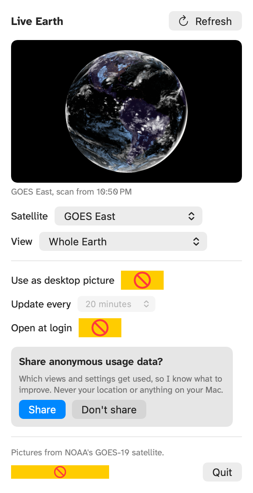

# Live Earth for Mac

A menu bar app that keeps a live satellite picture of Earth as your desktop picture. It's the
Mac side of the [Live Earth lab](https://kylepace.dev/live-earth/), using the same list of
satellites and views.

## What it does

- **Pick a satellite and a view:** GOES East and GOES West (the whole Earth, the U.S. and NOAA's
  regions), and Meteosat's regions (Europe, Africa, India, the Middle East).
- **Use as desktop picture:** sets the newest picture on every display and keeps it fresh every
  10, 20, 30 or 60 minutes, after the Mac wakes, and when displays change. The whole Earth sits
  round on black; regions are trimmed of NOAA's logo and caption and cropped to each display.
- **Open at login**, **Refresh** and a link to the web lab.
- **Usage data:** asks first. Nothing goes to Amplitude until you say yes.

Not in this first version: Meteosat's and Himawari's whole-Earth views. Meteosat's needs the
web viewer's reprojection; Himawari comes from CIRA's SLIDER, whose terms are only settled for
the web lab.

## How it works

- `scripts/export-mac-views.py` (repo root) copies the views from `src/lib/views.ts` into
  `LiveEarth/Resources/views.json`. Run it after changing views.ts.
- `Pictures.swift` finds the newest scan the same way the web lab does (`src/lib/goes.ts`,
  `src/lib/eumetsat.ts`): NOAA's predictable file names for GOES, EUMETSAT's map service for
  Meteosat, on-the-hour scans at least 45 minutes old so they're free Core data (CC BY 4.0).
  The app asks NOAA and EUMETSAT directly; it doesn't use the lab's Cloudflare relay.
- `Desktop.swift` draws each display's picture and sets it with `NSWorkspace`. Each picture
  gets a new file name (macOS keeps showing a picture whose name didn't change) in the app's
  sandboxed Application Support folder, and older ones are deleted.
- Sandboxed, with network access only. Fonts: Atkinson Hyperlegible Next, from KitchenUI.

Outside hosts: `cdn.star.nesdis.noaa.gov` (GOES pictures) and `view.eumetsat.int` (Meteosat),
the same ones the lab uses, plus Amplitude once you opt in.

## Building

From `mac/`: `xcodegen generate`, then build the `LiveEarth` scheme. `make-icon.swift` draws
the icon from a real GOES whole-Earth picture (public domain).

Debug builds take `-snapshot <path>`: they draw the menu to a PNG and quit, for checking the
menu without opening it. The app is sandboxed, so the path has to be inside its container
(`~/Library/Containers/dev.kylepace.live-earth/Data/tmp/`). `-noAnalytics` turns usage data off.

Bundle ID `dev.kylepace.live-earth`, version 0.1.0. Not in App Store Connect or TestFlight yet.

## Analytics

The kylepace.dev Amplitude project (902556), like the web lab, with `experiment: live-earth`
and `app: mac` on every event. Events (all in the tracking plan): Changed Satellite, Changed
View, Turned On/Off Desktop Picture, Changed Update Interval, Updated Desktop Picture (button
only), Turned On/Off Open at Login, Opened Live Earth Web, Turned On/Off Usage Sharing.
